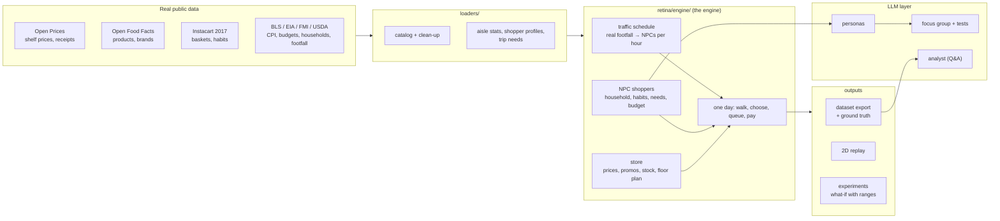

# RETINA — Retail Intelligence & Agent Simulation

**A synthetic retail data factory.** Thousands of NPC shoppers with *real* habits walk a virtual
supermarket stocked with *real* products and *real* shelf prices, and every decision they make
becomes product-level data: receipts, trips, stockouts, promotions, waste, profit.

> Every row RETINA produces is **SIMULATED**. No real customer is in the data. Every input carries
> a label — `REAL_OBSERVED`, `PUBLIC_STATISTIC`, `ESTIMATED` or `SIMULATED` — and estimated values
> are never presented as real.

**Why?** Real retail transaction data is private and almost never shared. Synthetic data that
*behaves* like the real thing lets you practise and test forecasting, basket analysis,
recommendation, promotion uplift and stockout models. RETINA also writes the **ground truth** a
real store never sees (lost sales at empty shelves, why each promoted unit sold), so methods can
be checked against the right answer.

---

## Results at a glance

**Scorecard: 17 / 18 checks pass** against real data (Instacart orders, Open Prices receipts,
retail research). The one FAIL is shown on purpose — it is the next thing to improve.

**Realism against real baskets the simulator never saw** (held-out Instacart half, aisle level):

| measure | first version | now |
|---|---|---|
| Can a classifier tell simulated from real baskets? (AUC, 0.5 = no) | 0.854 | **0.734** |
| Train a model on RETINA, test on real data (vs training on real) | 94% | **97%** |
| Bought-together patterns (aisle lift correlation) | 0.29 | **0.63** |
| Aisle mix difference | 14.6% | **4.8%** |
| Repeat purchases (real: 60%) | 46% | **57%** |

**LLM shopper tests** (persona NPCs choosing among real products):

| test | Groq gpt-oss-120b | Gemini flash-lite | statistical engine |
|---|---|---|---|
| Price elasticity (research ≈ −2.5) | −3.0 | −2.3 | −2.3 |
| Re-buys their usual product | 36% | 56% | 65% |
| Picks a deal when offered | 34% | 23% | 3% |

LLM shoppers react to price realistically but are less loyal and more deal-driven than real
shoppers, so **the statistical engine makes the dataset** and LLMs are used as a focus-group and
explanation layer.

---

## Choose a store and watch it run

```powershell
retina --store supermarket --days 10 --mind fast   # the next 10 days (continues where it stopped)
retina --stores                                    # the store formats: supermarket, supercenter, neighborhood, convenience
python -m retina.engine.studio              # pick a store format, watch NPCs walk while the data is made
python -m retina.engine.studio --compare    # every format side by side
```

| store format | sized like | real shoppers / week | range on the shelves | trip size | checkout |
|---|---|---|---|---|---|
| Supercenter | Walmart Supercenter-type big box | ~25,700 (Walmart 10-K) | full grocery range | ~10 items | 20 lanes |
| Supermarket | typical US supermarket | 13,583 (FMI) | full grocery range | ~10 items | 8 lanes |
| Neighborhood market | small-format grocer | ~8,000 (estimated) | best-selling 35% | ~8 items | 5 lanes |
| Convenience | 7-Eleven-type, open 24 h | ~7,400 (NACS) | best-selling 8%, drinks & snacks heavy | 1-2 items | 2 counters |

Store formats are **generic**, sized with public numbers - not copies of any real retailer, and
they do not predict any real store. The studio opens the chosen store (or carries on where it
stopped), prints each hour's shoppers and sales, appends the receipts to `data\live\<store>\`, and
writes `view.html`: the floor plan with every NPC walking, picking products and queuing, which
plays each day and then loads the next one by itself.

---

## Thinking NPCs (v2)

**Make data with the student model** - every NPC decides at the shelf with the trained student
(routine buys on autopilot; the store itself - traffic, prices, stock, checkout - is the engine).
No LLM, no key, no cost; choose how much data:

```powershell
retina --mind student --period 1m        # 1w, 2w, 1m, 3m, 6m or 1y (a year: ~15 min for the supermarket)
retina --mind student --period 1y --store convenience --reset
retina --mind student --report           # what the student shoppers did
```

```powershell
retina --store supermarket --mind mix --days 10    # a panel of 50 NPCs think; the rest is the engine
retina --store supermarket --mind mix --report     # LLM panel vs engine crowd
retina --mind mix --provider fake --days 3         # dry run: fixed rules, no LLM, no key
```

The engine still makes each NPC's shopping list. At the shelf, a **router** sends each choice to
the cheapest mind that can make it: **autopilot** for routine buys (the usual product, in stock,
price as remembered), the **LLM teacher** for everything worth a thought (something new, the usual
is sold out or dearer, a deal next to it, plus a 5% check). Up to 5 NPCs share one request;
Python checks every answer, and a bad or missing one falls back to the engine. Each thinking NPC
has a **memory card** (SQLite) - persona, past trips, prices paid, empty shelves - so a returning
NPC is the same person. Every decision is logged (`decisions.csv`): training data for the
student model that comes next.

- **Same data every time:** answers are cached per NPC + day + situation, so a rerun - or the
  same days in pieces (4 + 6 = 10) - gives byte-identical data and costs no LLM calls.
- **Free tiers respected:** a rate limiter paces requests under each provider's per-minute limits,
  counts daily use, and an estimate of requests and tokens is shown before every run.

First real run (supermarket, 10 days, Groq + Gemini, 12 Oct 2026; SIMULATED):

| | trips | repeat buys | deal lines | own-price elasticity* |
|---|---|---|---|---|
| LLM panel (50 NPCs) | 42 | 49% | 27% | −1.4 |
| engine crowd | 1,828 | 45% | 12% | −2.0 |

330 LLM choices, 2 fell back to the engine, 13 requests, ~67,000 tokens.
*Conditional logit on the same option sets; research on grocery choice ≈ −2.5. Small sample: a
first look, not a verdict. As in v1, LLM shoppers are more deal-driven than the engine.

### The student model (v2)

```powershell
retina collect --decisions 3000            # varied situations labelled by Groq (free tier, stops at 80%)
retina collect --compare gemini --items 800   # a second LLM on the same situations (its own free quota)
retina collect --paste-pack 1000 --which unlabelled   # ready-to-paste messages for a chat AI (ChatGPT, Codex)
retina collect --paste-read data\teacher\paste --teacher chatgpt/<model>   # read its replies back
retina collect --compare-with chatgpt/<model>          # agreement and repeat/deal share by situation type
retina train --teacher all --balance family --choose realism --price-target -2.5
retina --mind mix --student only --days 56   # thinking NPCs with no LLM call at all
```

A small model learns the shelf choices of LLM "teachers", so thinking NPCs need (almost) no LLM.
**Collect mode** takes real store states and varies them on purpose (price up, deal next to the
usual, usual sold out, remembered price); options are shuffled so position cannot matter.

**Several teachers, balanced by family.** No single LLM shops like people: on the same situations
the teachers agree only 43-60% with each other (Groq agrees 65% with itself). In normal
situations real shoppers re-buy a product ~60% of the time (Instacart); Groq (gpt-oss) and GPT-5
re-buy ~30-37%, Claude ~44-71%, Gemini 60% - without being told the target. So the student learns
from all of them, and each model family (OpenAI, Anthropic, Google) counts the same in training, so
the biggest family cannot decide alone. Leaving any one family out made the student less realistic.

**Chosen by realism, not by copying.** Training splits by NPC (test NPCs are never seen) and
compares random, the v1 engine, a conditional logit and a LightGBM ranker. With `--choose realism`
the model closest to real shoppers on validation NPCs is kept. The student **draws** its choice from
its probabilities (seeded dice), like a person who does not always buy the same thing - always
taking the top option over-states habits (71% vs 55% re-buys).

**One ESTIMATED correction.** Every LLM teacher reacts to price about half as much as real shoppers
(own-price elasticity ~-1.2 vs research ~-2.5). `--price-target -2.5` adds one price term, tuned
without labels on training NPCs and checked on test NPCs; it is inside the ONNX file and marked
ESTIMATED in the model card.

Current student (4,608 labels from 6 teachers; test NPCs; SIMULATED):

| | agreement with teachers | re-buys (natural, drawn) | own-price elasticity |
|---|---|---|---|
| Groq-only student | 61-64% | 37-38% | -0.7 to -0.9 |
| all teachers, balanced, chosen by realism | 55% | 58% | -1.03 |
| same + price correction (**used**) | 54% | 55% | -2.36 |
| real shoppers | - | ~60% | ~-2.5 |

56 simulated days with `--student only`: 1,857 student choices, 0 LLM calls, about a minute.
Student shoppers buy ~39% of units on deal against a real ~24-31% (Nielsen 2019-2020, Bernstein
2022); the engine crowd buys ~15% - the truth lies between them. In mix runs a confident student
decides and an unsure one asks the teacher, whose answer becomes a new label.

---

## Releases, local app and Docker (v2)

**Sample datasets.** Every version tag (`v*`) makes GitHub Actions run `retina release`: the four
store formats, one simulated year each (engine), plus a thinking-NPC dataset made by the student
model once one is trained - no LLM in CI. The release page gets one zip per dataset (Parquet + CSV,
dataset card, data dictionary, scorecard), `manifest.json` (sha256, rows, how it was built) and
release notes. CI builds have no private Instacart per-shopper profiles and no realism test, and
each dataset card says so. Nothing a visitor does can start a build. Try it locally:

```powershell
retina release --version test --days 7 --stores convenience     # -> dist/test/
```

**Generate data in the website** (your PC only, binds to 127.0.0.1):

```powershell
cd web; npm install; npm run build; cd ..     # once: build the website
retina app                                    # then open http://localhost:8000 -> Generate
```

Choose the store, the shoppers (every NPC decided by the student model, or engine only) and how much
data - 1 week, 1 month, 3 months, 6 months, 1 year or any number of days (1-365) - press Generate,
watch the progress (day 12 of 30), then download **business-ready sales data** (every run, also from
the command line, writes them to `data/live/<run>/business/`):

| file | one row per | for |
|---|---|---|
| `sales_transactions.csv` | product line sold | sales, discounts, cost, gross profit, basket analysis |
| `baskets.csv` | receipt | customer, arrival / checkout time, items, total |
| `daily_product_sales.csv` | product x day | demand forecasting: units, sales, promotion, lost sales |
| `inventory_daily.csv` | product x day with a stock movement | opening, delivered, wasted, sold, closing, out of stock |
| `daily_store_kpis.csv` | day | customers, sales, margin, basket, stock-outs, waste, whole-store stock value |
| `products.csv` / `customers.csv` / `promotions.csv` | product / customer / promotion | masters and the promotion calendar |

Plus `DATA_DICTIONARY.md` and `DATASET_CARD.md`; the simulation logs come in `extra/`. All tables agree
to the cent (tested): the same net sales in transactions, baskets, daily sales, KPIs and customers, and
every stock row balances (opening - waste + delivered - sold = closing). A year of the supermarket takes ~15 minutes; CSV zips
about 10x (25 days: 56 MB of CSV -> 6 MB ZIP). The API is at http://localhost:8000/docs.

**Docker:**
```powershell
docker build -t retina .
docker run -p 127.0.0.1:8000:8000 -v retina-runs:/app/data/live retina
```
LLM keys are passed at start (`-e GROQ_API_KEY`), never stored in the image; the image has no raw
Instacart files or per-shopper profiles.

---

## Your own products (v2)

```powershell
retina products --template                       # example CSV + the 124 aisles to choose from
retina products --check my_products.csv          # every row checked, nothing changed
retina --products my_products.csv --days 10      # a store that sells ONLY your products
retina --products my_products.csv --products-mode add   # the US catalog plus yours
retina export --products my_products.csv --days 30 --csv  # a dataset of that store
```

Columns: `name, brand, category, price, pack_size` (+ optional `aisle`, `promo_price`,
`popularity`, `shelf_life_days`, `product_id`). Prices in US dollars for now (NPC budgets come
from US statistics). The file may be UTF-8 (with or without BOM) or Windows-1252, comma-, semicolon-
or tab-separated, up to 50,000 rows; pack sizes like `500 g`, `12 x 330 ml`, `1 lb 11.2 oz` are read.

- **Every product sits in one of 124 aisles**, so the engine can use what real shoppers do there.
  A category that is not an aisle gets a *suggestion* (`biscuits` → did you mean `cookies cakes`?),
  never an automatic change: you confirm it in an `aisle` column.
- **Not sold here:** NPCs still want what real shoppers want. A want in an aisle your store does not
  sell is recorded as **lost demand** (`not_sold_here.csv`), never swapped for something else.
  NPC histories and habits come only from products the store sells.
- **Honest labels:** uploaded values are `USER_PROVIDED`; defaults we fill in are `ESTIMATED`.
  Scorecard checks that compare with the Instacart aisle mix say **N/A** for a custom range.
- **Spreadsheet-safe:** a text cell starting with `= + - @` is written as text in every CSV RETINA
  makes, so a product name can never run as an Excel formula.

Test run (200 real products in 25 aisles, supermarket, 3 weeks; SIMULATED): those aisles hold ~60%
of what real shoppers buy; ~1.8 of ~9.9 wanted items per trip were "not sold here".

---

## How it works



**One shopping trip**
1. The traffic schedule says how many NPCs walk in each hour (real footfall, scaled 1:10).
2. Each NPC builds a list from **needs** (things that ran out at home), **habits** (their usual
   products), **missions** (pasta → pasta sauce, from real aisle pairs) and new picks.
3. They walk the floor plan, see shelves, react to **prices they remember**, **promotions**
   (brand switch / stock up / impulse), **empty shelves** (research-based reactions) and their
   **food budget**.
4. They queue at a checkout and pay. Every line goes on a receipt with the reason it was bought.

---

## Quick start (Windows, Python 3.14)

```powershell
python -m venv .venv
.venv\Scripts\activate
pip install -r requirements.txt
pip install -e .          # adds the `retina` command (editable: uses this folder's code and data)

# 1) build the data layer once (downloads public data; Instacart files go in data\raw\instacart)
python loaders\loader.py
python loaders\clean_catalog.py
python loaders\aisle_stats.py
python loaders\shopper_profiles.py
python loaders\trip_needs.py

# 2) simulate a year and see the scorecard
python -m retina.engine.retina_mart
python -m retina.engine.realism --final

# 3) export a ready-to-use dataset (Parquet + CSV, data dictionary, dataset card)
python -m retina.engine.export --csv

# 4) run the automated tests (about 30 seconds)
python -m pytest
```

The repository includes the processed data layer (`data\processed`), so steps 2-4 work right
after cloning - except the per-shopper Instacart profiles file, which is not shared (Instacart
terms); RETINA then draws habits from the published distributions instead.

**More things to run**

| command | what it does |
|---|---|
| `retina --store supermarket --days 10` | run the store day by day (continues where it stopped); `--watch`, `--view`, `--status`, `--reset` |
| `python -m retina.engine.studio` | choose a store format and watch NPCs walk while data is made |
| `python -m retina.engine.traffic` | the hourly footfall schedule |
| `python -m retina.engine.replay --day 33` | 2D replay of one day: follow any shopper on the floor plan |
| `python -m retina.engine.experiment scenarios\example.json` | what-if test (price, promotion, delisting, stock) with ranges over several seeds |
| `python -m retina.engine.personas --n 20` | LLM-written personas from each NPC's facts (fact-checked) |
| `python -m retina.engine.focus --n 10` | focus group: persona NPCs choose real products with an LLM |
| `python -m retina.engine.llm_eval` | price / habit / popularity tests for LLM shoppers, per model |
| `python -m retina.engine.analyst` | ask questions about the simulated store in plain English |

LLM keys come from environment variables only (`$env:GROQ_API_KEY`, `$env:GEMINI_API_KEY`);
`auto` mode falls back Groq → Gemini → Ollama (local, free).

---

## The exported dataset

`python -m retina.engine.export` → `data\export\retina_generic_supermarket_seed42\`

| table | rows (1 year) | one row = |
|---|---|---|
| transactions | ~670,000 | one product line on a receipt (price, promo, trip type, reason) |
| trips | ~71,000 | one trip: arrival, walk, queue, budget, spend |
| products | ~19,000 | one product on the shelves, with data labels |
| customers | 2,188 | one NPC customer: habits, household, income, budget |
| daily_store / hourly_traffic | 365 / ~5,800 | store KPIs per day / trips per hour |
| truth/ | — | lost sales, promotion effects, promotion calendar, waste |

Each export includes `DATASET_CARD.md` (how it was made, quality, limits, licences),
`DATA_DICTIONARY.md` (every column with its label) and `checks.json` (totals that must agree).

---

## Project structure

```
loaders/      build the data layer from public sources (catalog, aisle stats, profiles, trip needs)
retina/       the Python package (`pip install -e .` gives the `retina` command, retina/cli.py)
  mind/            v2: router, autopilot, LLM teacher (batched, cached), run estimate, report
  memory/          v2: NPC memory cards and decision log (SQLite, one file per run)
  products/        v2: your own products - read, check ("did you mean"), convert (USER_PROVIDED)
  app/             v2: local app (FastAPI, retina app)
  student/         v2: student model - collect, train, ONNX
  release.py       v2: retina release (sample datasets for GitHub Releases)
retina/engine/   the v1 engine and tools (run one with python -m retina.engine.<tool>)
  config.py        settings from the store profile, random streams
  world.py         store, shoppers, prices, stock          households.py  household, income, budget
  shopping.py      how a trip and a day run                floor.py       floor plan, walking, checkout
  traffic.py       real footfall -> NPCs per hour          engine.py      day-by-day simulation, scenarios
  reports.py       logs, summaries, scorecard              realism.py     test against held-out real baskets
  live.py          run day by day from saved state         export.py      dataset export
  experiment.py    what-if experiments                     replay.py      2D replay page
  llm.py / personas.py / focus.py / llm_eval.py / analyst.py   the LLM layer
stores/       store formats (supercenter, supermarket, neighborhood market, convenience):
              every assumption with its data label and source
scenarios/    what-if scenario files
models/       the trained student model (models/student)
web/          the website (v2, later)
```

---

## Data sources and licences

| source | used for | licence |
|---|---|---|
| Open Prices (Open Food Facts) | US shelf prices, promotions, receipts | ODbL 1.0 |
| Open Food Facts family | product names, brands, categories, pack sizes | ODbL 1.0 |
| Instacart Online Grocery Shopping Dataset 2017 | shopper habits, aisle shares, pairs (statistics only) | non-commercial use; raw files not redistributed |
| U.S. BLS (CPI, Consumer Expenditure), EIA (RECS 2024) | price changes, food budgets, household sizes | public domain |
| FMI, USDA ERS (ATUS) | store footfall, weekday pattern | published statistics |
| Gruen, Corsten & Bharadwaj 2002; Van Heerde et al. 2004; Bijmolt et al. 2005 | stockout reactions, promotion effects, elasticity | research |

The test file `tests/fixtures/products_200.csv` is a small extract of the catalog (Open Food Facts
names/brands/sizes, Open Prices prices) and is shared under ODbL 1.0 - see `tests/fixtures/README.md`.

RETINA is a **non-commercial portfolio project**. Store formats are generic ("supermarket"),
never presented as any real retailer.

## Honest limits

- Shopper habits come from online grocery orders (Instacart, 2017); a physical store may differ.
- 59% of products have estimated popularity; the assortment mixes retailers and years.
- No seasonality or holidays yet; walking and checkout times are estimated.
- Re-buying the same product on the very next trip is too weak (13% vs real 28%).
- LLM shoppers are evaluated but not used to make the engine dataset (see results above).
- The student copies LLM teachers, not real people: it is checked against public statistics
  (re-buy rate, price elasticity), and one price correction is ESTIMATED.
- Share of units bought on deal: engine crowd ~15%, student shoppers ~39%, real US ~24-31%.

## Tests

`python -m pytest` runs 62 checks in about two minutes (also on every push, via GitHub Actions):
same seed gives the same data; stopping and continuing a run changes nothing; receipts, trips and
daily totals agree; prices and promotions make sense; store traffic and households follow their
inputs; every store format runs and differs as it should; the LLM guardrails (JSON reading, persona fact check, valid choices) work without any key.
Thinking NPCs (with stand-in teachers, no key): a mix run stopped and continued equals one run; the
cache makes a rerun identical with zero LLM calls; a broken LLM falls back to the engine; memory
rolls back an unsaved day; big batches are split under the token cap; the rate limiter waits.
Your own products: files with a BOM, Windows-1252, semicolons, quoted commas are read; rows over
the limit are refused; "did you mean" never changes a row; USD only; formula cells are neutralised;
200 uploaded products run in all four store formats with lost demand recorded and histories only
from products the store sells; the Instacart-mix scorecard checks say N/A.
Student model (fixed-rule stand-in teachers): it learns the teacher far better than random or the
engine; ONNX gives the same answers as Python (also with the price correction inside); position is
not a feature; `--student only` makes no LLM call AND the student's pick is what the shopper buys;
the draw varies but repeats with the same dice; family balance gives each family the same weight;
the realism choice keeps the closer model; paste packs round-trip (missing and wrong answers are
listed, nothing is imported twice); collect mode stops at 80% of the free day.

## Skills shown

Agent-based simulation · statistical calibration and held-out validation (classifier two-sample
test, train-synthetic-test-real) · experiment design with common random numbers · data
engineering (loaders, Parquet, incremental runs, data dictionary, consistency checks) · LLM
engineering (provider fallback, caching, grounding, fact-checking, evaluation) · honest data
labelling and licensing.
