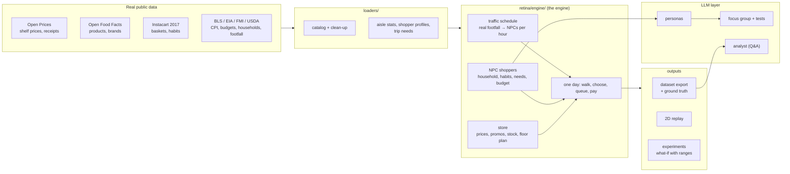

# RETINA — Retail Intelligence & Agent Simulation

**A synthetic retail data factory.** Thousands of NPC shoppers with *real* habits walk a virtual
supermarket stocked with *real* products and *real* shelf prices, and every decision they make
becomes product-level data: receipts, trips, stockouts, promotions, waste, profit.

> Every row RETINA produces is **SIMULATED**. No real customer is in the data. Every input carries
> a label — `REAL_OBSERVED`, `PUBLIC_STATISTIC`, `ESTIMATED` or `SIMULATED` — and estimated values
> are never presented as real.

**Why?** Real retail transaction data is private and almost never shared. Synthetic data that
*behaves* like the real thing lets you practise and test forecasting, basket analysis,
recommendation, promotion uplift and stockout models. RETINA also writes the **ground truth** a
real store never sees (lost sales at empty shelves, why each promoted unit sold), so methods can
be checked against the right answer.

---

## Results at a glance

**Scorecard: 17 / 18 checks pass** against real data (Instacart orders, Open Prices receipts,
retail research). The one FAIL is shown on purpose — it is the next thing to improve.

**Realism against real baskets the simulator never saw** (held-out Instacart half, aisle level):

| measure | first version | now |
|---|---|---|
| Can a classifier tell simulated from real baskets? (AUC, 0.5 = no) | 0.854 | **0.734** |
| Train a model on RETINA, test on real data (vs training on real) | 94% | **97%** |
| Bought-together patterns (aisle lift correlation) | 0.29 | **0.63** |
| Aisle mix difference | 14.6% | **4.8%** |
| Repeat purchases (real: 60%) | 46% | **57%** |

**LLM shopper tests** (persona NPCs choosing among real products):

| test | Groq gpt-oss-120b | Gemini flash-lite | statistical engine |
|---|---|---|---|
| Price elasticity (research ≈ −2.5) | −3.0 | −2.3 | −2.3 |
| Re-buys their usual product | 36% | 56% | 65% |
| Picks a deal when offered | 34% | 23% | 3% |

LLM shoppers react to price realistically but are less loyal and more deal-driven than real
shoppers, so **the statistical engine makes the dataset** and LLMs are used as a focus-group and
explanation layer.

---

## Choose a store and watch it run

```powershell
retina --store supermarket --days 10 --mind fast   # the next 10 days (continues where it stopped)
retina --stores                                    # the store formats: supermarket, supercenter, neighborhood, convenience
python -m retina.engine.studio              # pick a store format, watch NPCs walk while the data is made
python -m retina.engine.studio --compare    # every format side by side
```

| store format | sized like | real shoppers / week | range on the shelves | trip size | checkout |
|---|---|---|---|---|---|
| Supercenter | Walmart Supercenter-type big box | ~25,700 (Walmart 10-K) | full grocery range | ~10 items | 20 lanes |
| Supermarket | typical US supermarket | 13,583 (FMI) | full grocery range | ~10 items | 8 lanes |
| Neighborhood market | small-format grocer | ~8,000 (estimated) | best-selling 35% | ~8 items | 5 lanes |
| Convenience | 7-Eleven-type, open 24 h | ~7,400 (NACS) | best-selling 8%, drinks & snacks heavy | 1-2 items | 2 counters |

Store formats are **generic**, sized with public numbers - not copies of any real retailer, and
they do not predict any real store. The studio opens the chosen store (or carries on where it
stopped), prints each hour's shoppers and sales, appends the receipts to `data\live\<store>\`, and
writes `view.html`: the floor plan with every NPC walking, picking products and queuing, which
plays each day and then loads the next one by itself.

---

## How it works



**One shopping trip**
1. The traffic schedule says how many NPCs walk in each hour (real footfall, scaled 1:10).
2. Each NPC builds a list from **needs** (things that ran out at home), **habits** (their usual
   products), **missions** (pasta → pasta sauce, from real aisle pairs) and new picks.
3. They walk the floor plan, see shelves, react to **prices they remember**, **promotions**
   (brand switch / stock up / impulse), **empty shelves** (research-based reactions) and their
   **food budget**.
4. They queue at a checkout and pay. Every line goes on a receipt with the reason it was bought.

---

## Quick start (Windows, Python 3.14)

```powershell
python -m venv .venv
.venv\Scripts\activate
pip install -r requirements.txt
pip install -e .          # adds the `retina` command (editable: uses this folder's code and data)

# 1) build the data layer once (downloads public data; Instacart files go in data\raw\instacart)
python loaders\loader.py
python loaders\clean_catalog.py
python loaders\aisle_stats.py
python loaders\shopper_profiles.py
python loaders\trip_needs.py

# 2) simulate a year and see the scorecard
python -m retina.engine.retina_mart
python -m retina.engine.realism --final

# 3) export a ready-to-use dataset (Parquet + CSV, data dictionary, dataset card)
python -m retina.engine.export --csv

# 4) run the automated tests (about 30 seconds)
python -m pytest
```

The repository includes the processed data layer (`data\processed`), so steps 2-4 work right
after cloning - except the per-shopper Instacart profiles file, which is not shared (Instacart
terms); RETINA then draws habits from the published distributions instead.

**More things to run**

| command | what it does |
|---|---|
| `retina --store supermarket --days 10` | run the store day by day (continues where it stopped); `--watch`, `--view`, `--status`, `--reset` |
| `python -m retina.engine.studio` | choose a store format and watch NPCs walk while data is made |
| `python -m retina.engine.traffic` | the hourly footfall schedule |
| `python -m retina.engine.replay --day 33` | 2D replay of one day: follow any shopper on the floor plan |
| `python -m retina.engine.experiment scenarios\example.json` | what-if test (price, promotion, delisting, stock) with ranges over several seeds |
| `python -m retina.engine.personas --n 20` | LLM-written personas from each NPC's facts (fact-checked) |
| `python -m retina.engine.focus --n 10` | focus group: persona NPCs choose real products with an LLM |
| `python -m retina.engine.llm_eval` | price / habit / popularity tests for LLM shoppers, per model |
| `python -m retina.engine.analyst` | ask questions about the simulated store in plain English |

LLM keys come from environment variables only (`$env:GROQ_API_KEY`, `$env:GEMINI_API_KEY`);
`auto` mode falls back Groq → Gemini → Ollama (local, free).

---

## The exported dataset

`python -m retina.engine.export` → `data\export\retina_generic_supermarket_seed42\`

| table | rows (1 year) | one row = |
|---|---|---|
| transactions | ~670,000 | one product line on a receipt (price, promo, trip type, reason) |
| trips | ~71,000 | one trip: arrival, walk, queue, budget, spend |
| products | ~19,000 | one product on the shelves, with data labels |
| customers | 2,188 | one NPC customer: habits, household, income, budget |
| daily_store / hourly_traffic | 365 / ~5,800 | store KPIs per day / trips per hour |
| truth/ | — | lost sales, promotion effects, promotion calendar, waste |

Each export includes `DATASET_CARD.md` (how it was made, quality, limits, licences),
`DATA_DICTIONARY.md` (every column with its label) and `checks.json` (totals that must agree).

---

## Project structure

```
loaders/      build the data layer from public sources (catalog, aisle stats, profiles, trip needs)
retina/       the Python package (`pip install -e .` gives the `retina` command, retina/cli.py)
  mind/ memory/ app/   v2, being built: NPC mind, NPC memory cards, local app
retina/engine/   the v1 engine and tools (run one with python -m retina.engine.<tool>)
  config.py        settings from the store profile, random streams
  world.py         store, shoppers, prices, stock          households.py  household, income, budget
  shopping.py      how a trip and a day run                floor.py       floor plan, walking, checkout
  traffic.py       real footfall -> NPCs per hour          engine.py      day-by-day simulation, scenarios
  reports.py       logs, summaries, scorecard              realism.py     test against held-out real baskets
  live.py          run day by day from saved state         export.py      dataset export
  experiment.py    what-if experiments                     replay.py      2D replay page
  llm.py / personas.py / focus.py / llm_eval.py / analyst.py   the LLM layer
stores/       store formats (supercenter, supermarket, neighborhood market, convenience):
              every assumption with its data label and source
scenarios/    what-if scenario files
web/          the website (v2, later)
```

---

## Data sources and licences

| source | used for | licence |
|---|---|---|
| Open Prices (Open Food Facts) | US shelf prices, promotions, receipts | ODbL 1.0 |
| Open Food Facts family | product names, brands, categories, pack sizes | ODbL 1.0 |
| Instacart Online Grocery Shopping Dataset 2017 | shopper habits, aisle shares, pairs (statistics only) | non-commercial use; raw files not redistributed |
| U.S. BLS (CPI, Consumer Expenditure), EIA (RECS 2024) | price changes, food budgets, household sizes | public domain |
| FMI, USDA ERS (ATUS) | store footfall, weekday pattern | published statistics |
| Gruen, Corsten & Bharadwaj 2002; Van Heerde et al. 2004; Bijmolt et al. 2005 | stockout reactions, promotion effects, elasticity | research |

RETINA is a **non-commercial portfolio project**. Store formats are generic ("supermarket"),
never presented as any real retailer.

## Honest limits

- Shopper habits come from online grocery orders (Instacart, 2017); a physical store may differ.
- 59% of products have estimated popularity; the assortment mixes retailers and years.
- No seasonality or holidays yet; walking and checkout times are estimated.
- Re-buying the same product on the very next trip is too weak (13% vs real 28%).
- LLM shoppers are evaluated but not used to make the dataset (see results above).

## Tests

`python -m pytest` runs 18 checks in under a minute (also on every push, via GitHub Actions):
same seed gives the same data; stopping and continuing a run changes nothing; receipts, trips and
daily totals agree; prices and promotions make sense; store traffic and households follow their
inputs; every store format runs and differs as it should; the LLM guardrails (JSON reading, persona fact check, valid choices) work without any key.

## Skills shown

Agent-based simulation · statistical calibration and held-out validation (classifier two-sample
test, train-synthetic-test-real) · experiment design with common random numbers · data
engineering (loaders, Parquet, incremental runs, data dictionary, consistency checks) · LLM
engineering (provider fallback, caching, grounding, fact-checking, evaluation) · honest data
labelling and licensing.
